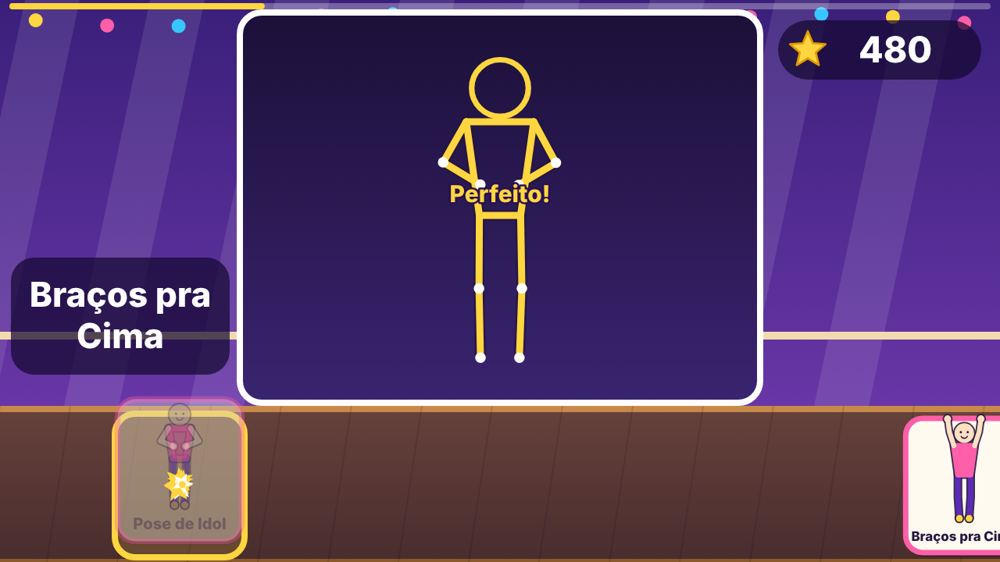

# Ensaio de Dança

> *Contributions in English (issues, pull requests, and discussions) are also very welcome! See [CONTRIBUTING.md](./CONTRIBUTING.md).*

Jogo de dança infantil no navegador, feito para brincar em casa nos fins de semana. A câmera lê o corpo com o MediaPipe, cartões de pose chegam no ritmo da música e a criança ganha estrelas por imitar cada pose. Não tem login nem anúncio, e funciona sem internet depois da primeira visita.

- **Tudo roda no aparelho.** A imagem da câmera é lida localmente e nunca é gravada nem enviada para lugar nenhum.
- **Músicas sintetizadas prontas para jogar** e suporte para carregar seus próprios arquivos de áudio na Área dos Pais (guardados apenas no navegador daquele aparelho). **Pull requests com áudio, letra ou imagem de terceiros são recusados.**
- **Sem derrota.** Toda mensagem para a criança é positiva e a nota mínima é sempre 1 estrela.



## Instalar

Precisa do Node 20.19 ou mais novo.

```bash
npm ci
npm run setup:mediapipe   # copia o wasm e baixa os modelos de pose para public/mediapipe/
npm run dev               # abre no navegador local
```

O `setup:mediapipe` precisa de internet uma vez. Depois disso o jogo carrega o MediaPipe do próprio endereço, sem CDN.

## Jogar no celular

O navegador só libera a câmera em `https://` ou em `localhost`. Por isso existem dois caminhos:

1. **Abrir a versão publicada em HTTPS** (Cloudflare Workers / Pages) no endereço do projeto (`/jogar/`).
2. **Na rede de casa, só para testar:** rode `npm run dev` no computador e, no Chrome do Android com o celular ligado por cabo USB, use o encaminhamento de porta de `chrome://inspect` (porta 5173) para abrir `http://localhost:5173` no celular.

No celular:

1. Abra o endereço no Chrome e, no menu do navegador, escolha "Adicionar à tela inicial". O jogo passa a abrir em tela cheia, deitado, e funciona sem internet.
2. Apoie o celular deitado a uns 2 metros, na altura da cintura, num lugar bem iluminado e com o chão livre.
3. Toque em "Começar" e aceite o pedido da câmera. Daí em diante a criança escolhe tudo levantando a mão e segurando em cima do botão por 1 segundo.
4. Para pausar durante a música, é só levantar as duas mãos.

A música "Aquecimento" é sintetizada pelo próprio jogo e já vem liberada, então dá para jogar antes de carregar qualquer arquivo.

## Área dos Pais

No menu, segure o botão "Pais" (canto de baixo, à direita) por 3 segundos.

### Carregar as músicas

As cinco coreografias de exemplo para uso doméstico aparecem no menu com cadeado até terem áudio: Brilho, Meu Pequeno Guaraná, O Som da Nossa Voz, Letal e Não Tem Perdão.

1. Em "Músicas", escolha o arquivo de áudio (MP3, M4A, WAV ou OGG) de cada uma.
2. O cadeado some na hora. O arquivo fica no IndexedDB do navegador daquele aparelho.
3. "Remover o áudio" apaga o arquivo e devolve o cadeado.

Os arquivos de áudio nunca entram no repositório nem na publicação.

### Tocar pelo YouTube (sem arquivo de áudio)

Quem não tem o arquivo pode usar um vídeo do YouTube. A música toca dentro do jogo, num player pequeno no canto de cima (`youtube-nocookie.com`), e começa sozinha junto com a dança. Não precisa abrir o YouTube nem dar play na hora certa.

1. No YouTube, abra o vídeo da música e copie o link (Compartilhar → Copiar link).
2. Na Área dos Pais, cole o link na linha "YouTube" da música e toque em "Salvar link". O cadeado some.
3. Toque em "Testar a batida": o vídeo toca com um clique em cada batida (o clique mais agudo marca o começo de cada grupo de 4).
4. Toque em "Começou a batida!" no primeiro tempo forte da música. Isso acerta a maior parte da diferença (vídeos costumam ter uma introdução).
5. Acerte o resto com "−100 / −10 / +10 / +100 ms" até os cliques caírem junto com a batida. "+" faz os passos virem mais tarde e "−" mais cedo. O ajuste fica guardado para aquela música, naquele aparelho.

Como funciona: o jogo usa a API oficial de player do YouTube (nada é baixado). O vídeo começa a carregar sem som enquanto a criança se posiciona na calibração e fica parado no ponto certo; quando a contagem acaba, ele toca e o relógio da dança passa a ser o tempo do próprio vídeo. Se o vídeo engasgar para carregar, os cartões esperam junto; na pausa, o vídeo pausa e volta do mesmo ponto.

Limitações:

- Precisa de internet (o resto do jogo funciona offline; essas músicas não).
- Pode aparecer anúncio antes do vídeo. O jogo tenta passar o anúncio sem som durante a calibração, mas um anúncio longo pode atrasar o começo.
- Alguns vídeos não deixam tocar fora do YouTube (muitos clipes oficiais de gravadora). Nesse caso a Área dos Pais mostra o aviso no teste e, na dança, o jogo segue com palminhas no ritmo da música. Tente outro vídeo da mesma música (letra, áudio oficial, versão de fã).
- Se o arquivo de áudio e o link existirem juntos, o jogo usa o arquivo (mais preciso e funciona sem internet).
- O gravador de coreografias e "Marcar partes" continuam precisando do arquivo de áudio.
- No iPhone, se a música não começar sozinha, aparece "Toque no vídeo para a música começar".

### Marcar as partes de cada música

As coreografias já vêm com as partes e as poses de cada música, mas o tempo exato depende do arquivo que você carregou. Para acertar, toque em "Marcar partes" na música:

1. **Acertar a batida.** Toque em "Ouvir daqui": um metrônomo toca por cima da música. Se o clique estiver adiantado ou atrasado, ajuste o "Começo da batida (offsetMs)". Se o clique for se afastando da música, o BPM está errado: corrija o número ou use "Detectar BPM".
2. **Marcar o começo de cada parte.** Com a música tocando, aperte o botão "Marcar: ..." (ou a barra de espaço) no começo de cada parte, na ordem em que a lista mostra. Cada marca gruda na batida mais próxima.
3. Toque em "Guardar marcações". A música passa a ficar marcada como calibrada e as poses caem no lugar certo.

### Regravar as poses

Se alguma pose do catálogo não combina com o jeito da criança fazer, em "Poses" toque em "Regravar": a contagem dá 3 segundos, ela segura a pose por 2 segundos e o jogo guarda a média dos ângulos medidos. "Voltar ao original" desfaz.

### Configurações e cópia dos dados

- Modelo de detecção (leve para celular ou completo, mais preciso e mais pesado), volume, voz do narrador e os limites de nota em graus.
- "Exportar dados" baixa um JSON com progresso, configurações, personagens, coreografias e poses. "Importar dados" traz de volta, por exemplo em outro aparelho. O áudio não vai junto: carregue as músicas de novo.

## O que tem no jogo

- **Dançar:** fácil ou normal, com os modos Dupla (duas pessoas, uma nota para cada) e Estátua (a música para e quem fica parado ganha bônus).
- **Treinar:** a música toca na metade da velocidade e espera a pose.
- **Criar dança:** a criança dança, o jogo tira um retrato a cada 4 ou 8 batidas e a dança vira uma fase no menu.
- **Surpresa:** um adulto escolhe qualquer música do aparelho, o jogo detecta o BPM e sorteia as poses.
- **Meu grupo:** três personagens originais com nome, cores, cabelo e acessório, cachorro e gato que pulam a cada "Perfeito!", e o desenho no papel fotografado virando personagem.
- **Álbum e Turnê:** 12 medalhas e uma história de 5 shows. Cenários e figurinos abrem com 5, 15 e 30 estrelas.

## Privacidade

- **A câmera nunca sai do aparelho:** o vídeo é lido localmente pelo MediaPipe e nunca é gravado nem enviado pela rede.
- **Sem conta e sem rastreio:** não há login, cookies próprios, anúncios nem scripts de analytics de terceiros.
- **Placar online opcional:** desligado por padrão. Só envia dados (apenas um apelido gerado de lista fechada, música pública, nível, pontos e estrelas) se um adulto ligar a opção na Área dos Pais.
- A política completa está em `/privacidade` no site do projeto.

## Como contribuir

Este é um projeto pessoal mantido nos fins de semana, e contribuições são muito bem-vindas! Leia o guia completo em [CONTRIBUTING.md](./CONTRIBUTING.md) e o nosso [Código de Conduta](./CODE_OF_CONDUCT.md). Para relatar falhas de segurança ou privacidade, siga as instruções em [SECURITY.md](./SECURITY.md).

```bash
npm run check      # tipos, lint, testes de unidade e build
npm run test:e2e   # Playwright: jogo em modo dev e teste offline contra o build
```

Na primeira vez, `npx playwright install chromium` baixa o navegador dos testes. Os testes não usam câmera nem música de verdade. Estes parâmetros de endereço ajudam (só em modo dev):

| Parâmetro         | Para que serve                                                 |
| ----------------- | -------------------------------------------------------------- |
| `?sim=1`          | Pose simulada no lugar da câmera                               |
| `?debug=1`        | Painel com fps, visibilidade e os ângulos medidos              |
| `?cena=esqueleto` | Abre direto numa cena (`metronomo`, `esqueleto`, `danca`, ...) |
| `?semvoz=1`       | Sem voz: as falas aparecem como legenda                        |
| `?pessoas=2`      | Duas pessoas simuladas, para o modo Dupla                      |

Organização:

- `src/core/` regras e aparelho: ângulos, juiz, estrelas, relógio da música, áudio, câmera, MediaPipe, gestos, gravador, detector de BPM.
- `src/data/` schemas (zod), catálogo de poses, coreografias, progresso e armazenamento no IndexedDB.
- `src/game/` motor de cenas num único canvas, desenhos feitos em código e as telas.
- `tests/unit/` e `tests/e2e/` (com screenshots em `tests/e2e/screens/`).
- `docs/` documentos de especificação e planos. `PROGRESS.md` conta o que foi feito e provado em cada etapa e `DECISIONS.md` lista as decisões tomadas pelo caminho.

## Roteiro de teste em casa

Primeiro o adulto, sozinho:

1. Abrir no celular, adicionar à tela inicial e tocar em "Começar". A câmera liga e o menu aparece.
2. Abrir com `?debug=1`, levantar o braço direito e conferir que o painel diz "braço direito".
3. Jogar o "Aquecimento" no fácil até o resultado, usando só as mãos.
4. Na Área dos Pais, carregar uma música, tocar "Marcar partes", acertar a batida de ouvido e marcar as partes.
5. Jogar essa música e ver se os cartões chegam no tempo. Se chegarem cedo ou tarde, mexer no `offsetMs`.
6. Desligar o Wi-Fi e os dados, fechar e abrir o jogo: ele tem que abrir normalmente.
7. Colar o link do YouTube de uma música, "Testar a batida", acertar o ajuste e jogar: a música tem que começar sozinha no fim da contagem.

Depois com a criança:

1. Deixar ela escolher a música e o nível com a mão, sem ajuda. Reparar se algum botão é difícil de alcançar.
2. Uma música no fácil. Reparar se ela entende os cartões e se as poses saem "Perfeito" quando ela faz certo. Se uma pose nunca acerta, regravar essa pose com ela.
3. Mostrar a pausa com as duas mãos para o alto.
4. "Meu grupo": trocar cores e fotografar um desenho dela.
5. "Criar dança" com o Aquecimento e depois jogar a dança que ela criou.
6. Uma rodada de Dupla com um adulto ao lado.
7. Parar na dica de água, que aparece a cada 3 músicas seguidas.

## Licença e Avisos

- **Código-fonte:** licenciado sob a [Licença MIT](./LICENSE).
- **Documentação, catálogo de poses e coreografias:** licenciados sob a [CC BY 4.0](./LICENSE-CONTEUDO.md).
- **Software de terceiros:** veja [TERCEIROS.md](./TERCEIROS.md).
- **Aviso de não afiliação:** Projeto independente, sem relação com Netflix, Sony ou os artistas. Não inclui nem distribui músicas de terceiros.
